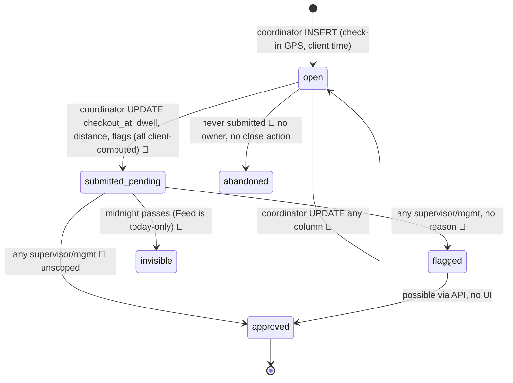
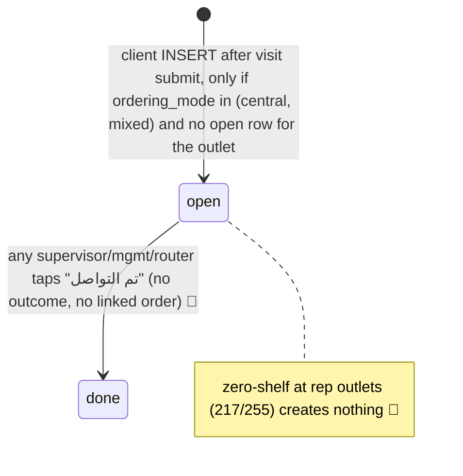
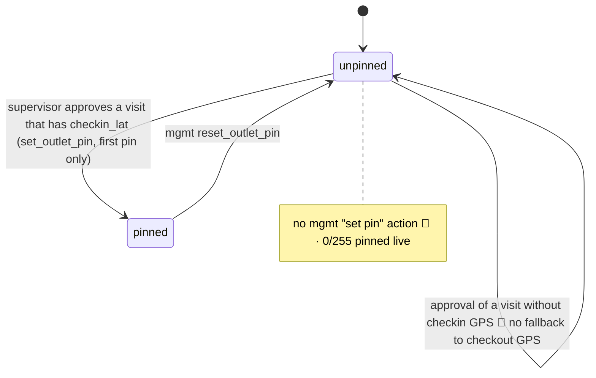
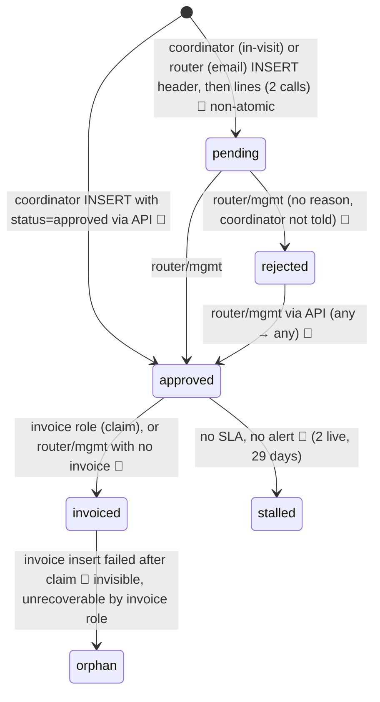
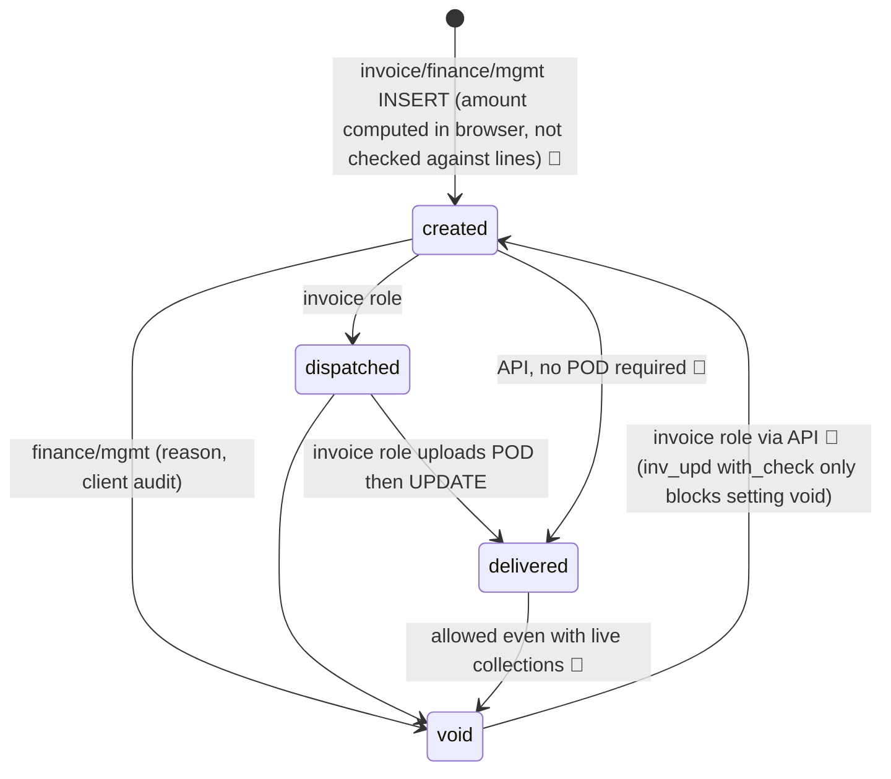

# Tannourine OS: app review, October 2026

**Date:** 2026-10-19 · **Scope:** usability, logic, roles and workflows · **Mode:** review only, no code, schema or data changed
**Evidence base:** repo at `fix/arabic-digit-parsing` (`0a920eb`), live DB `tlrhztjnzptuvkrkrjod` (read-only `SELECT`s plus the security advisor), PRD.md, CONTEXT.md.

**Labels.** **CONFIRMED** = seen in code or the live DB. **SUSPECTED** = likely but not proven. **QUESTION** = needs a business decision.

**What this review does not cover.** I did not run the app on a phone, so none of the field-ergonomics points were timed on a device. The RTL rendering points are labelled SUSPECTED for that reason. The RLS points are read from live `pg_policies`. I did not run them as a negative test from a coordinator session.

### Live state on 19 Oct 2026 (from the DB)

| Thing | Live value |
|---|---|
| Visits | 24 total (21 submitted, matching the 21 objects in `visit-photos`): 15 submitted and still `pending` (oldest 9 Sep), 3 open (never submitted: 14 Sep, 6 Oct, 17 Oct), 1 `approved`, 5 `flagged` (all 18 Oct, all عبدالمنعم, all reviewed by محمد رجب) |
| Orders | 2 `approved` (Zahran المعموره + كفر عبده, created 15–16 Sep, approved 20 Sep) · 3 `pending` (18 Oct, all Circle K with `payment_path='unknown'`) |
| Invoices / collections / containers / followups | 0 / 0 / 0 / 0 |
| Outlets with a GPS pin | **0 of 255** |
| Coordinators with any route rows | **2 of 7 active** (رنا, محمد عبد الحميد) |
| `audit_log` rows | 8 (7 `set_supervisor`, 1 `deactivate_user`) |
| Edge functions deployed | **none** |
| Triggers in `public` | **none** |
| Storage | `visit-photos`: 21 objects, 1.2 MB (≈60 KB each) · `pods`: bucket exists, empty |
| Last password sign-in* | عمرو (invoice) 1 Sep · سلمي (finance) 9 Sep · علي (router) 16 Sep · مروه 6 Oct · رجب أحمد and محمد حلمي never |

\* `last_sign_in_at` only changes on a password login. A saved session does not update it. علي approved orders on 20 Sep but his last sign-in is 16 Sep, so a stale date does not prove someone stopped using the app.

---

## 1. Top 5

**1. The order-to-cash chain stops at "approved", and no one in the system owns that gap.** The two approved Zahran orders have been waiting 29 days since approval (33 since they were created). There are 0 invoices. The invoice screen exists and works: `للفوترة` lists approved orders and shows a badge count (`App.tsx:85`). So the cause is not a missing screen. The cause is that nothing escalates. The router board's "معتمد — عند الفواتير" section has no age column (`Board.tsx:64-77`). No one is alerted. No screen anywhere shows "approved but not invoiced for more than X days". The invoice user has had no password sign-in since 1 Sep. That points to invoicing being done outside the app (SUSPECTED, QUESTION). Invoice creation is also non-atomic: the order is flipped to `invoiced` first, then the invoice is inserted (`ToInvoice.tsx:33-59`). If the second step fails, the order is `invoiced` with no invoice. It drops out of the only queue that lists it, and the invoice role cannot move it back because RLS only lets that role act on `approved` rows. Every order in that state is lost revenue that nobody can see. **Fix:** a single `invoice_order()` RPC, an age column with SLA colouring on the board and on the mgmt dashboard, and a business decision on who owns stalled orders.

**2. The database does not enforce any money state machine, and several insert policies let a field role write a finished state directly.** CONFIRMED from live `pg_policies`:
- `col_ins_coord` checks role, type and `received_by` only. A coordinator can insert a cheque with `status='cleared'` and any amount, on any invoice, for any outlet. That zeroes the invoice in `invoice_open` immediately.
- `orders_ins_coord` does not restrict `status`. A coordinator can insert an order that is already `approved` and skip علي completely.
- `inv_upd` lets the invoice role change `amount`, `outlet_id` or `legacy`, and move a `void` invoice back to `created`. The `with check` only blocks setting `void`.
- `col_upd` lets finance move `received` straight to `cleared`, or edit a cleared amount. There is no record of who deposited or cleared a cheque.

There are no triggers, so none of this is caught server-side. All of these rules exist only in the UI. **Fix:** status guards on inserts, transition triggers on `orders`, `invoices` and `collections`, and audit writes from those triggers (Batch 1–2).

**3. Receivables are understated, and the dashboard figure for them is wrong.** `invoice_open` subtracts every collection except `returned` (`schema.sql:274-275`). A cheque that is only `received` (in a coordinator's pocket, and possibly post-dated three months) already zeroes the invoice in aging. Then `Dashboard.tsx:95` says "منها X ج شيكات لسه في عهدة المنسقين", which describes custody as part of a total that has already removed it. Other gaps:
- No DSO.
- No per-outlet aging.
- Nothing ages from the delivery date.
- A cheque dated after 31 Dec of the current year cannot be entered (`coordinator/Cheques.tsx:98`). In December, a normal 60-day post-dated cheque is blocked.
- Voiding an invoice that already has cheques against it is allowed (`Corrections.tsx:53`). The cheques then fall out of aging but stay in custody, so the money is no longer tied to an open invoice.

Collection speed is the constraint on growth, and this screen currently reports cash as collected before it is collected. **Fix:** split open amounts into *uncollected*, *committed (cheque in hand or deposited)* and *cleared*. Add per-outlet aging and DSO. Block a void while live collections exist. (QUESTION 1 decides which figure is the headline number.)

**4. The supervisor review screen only shows today's visits.** That is why 15 visits are still pending. `Feed.tsx:28` filters submitted visits to `checkin_at >= today`. A visit that is not reviewed on the day it was made disappears at midnight. The tab badge (`App.tsx:79-80`) counts *all* pending submitted visits with no date filter and no team filter. So a supervisor sees a badge of 15 and a screen that says "مفيش زيارات النهارده". Ten of the 15 are Alexandria visits by محمد عبد الحميد. Only مروه can see those (scope الكل), and her last sign-in was 6 Oct. The same problem applies to stock data. Zero-shelf at `rep` outlets, which is 217 of 255 outlets, creates no follow-up (`VisitForm.tsx:108`). The only signal is a red pill on a card that disappears at midnight. Six of those September visits recorded 6–8 zero SKUs, and nothing was done about any of them. This is the "field data collected, nobody acts on it" pattern the app was built to end. **Fix:** make المتابعة a real backlog (oldest first, age pills, scoped badge). Give rep-outlet zeros an owner (QUESTION 4).

**5. The checks that would make field data trustworthy are not running.**
- Five of the seven active coordinators have no route rows. For them, "silent coordinator" can never fire and every visit counts as off-route.
- No outlet has a GPS pin, so `distance_m` is null on every visit and `far_from_pin` has never fired. A pin is only set when an approved visit has check-in GPS (`Feed.tsx:67`). The one approved visit had none. GPS failed at check-in on 7 of 21 submitted visits.
- After a visit is submitted, the app lands the coordinator on a screen whose main button is "جرد تاني" (`RouteToday.tsx:107,152`). It also resets `off_route` to `false` there. Live data matches this exactly: 18 Oct, رنا at ديستريك5, 18:25 `off_route=true` then 19:08 `off_route=false`, and that outlet is not on her route. عبدالمنعم shows the same pattern at الزمالك and three times at الجبخانه within 18 minutes.

So the 18 Oct "5 of 6 flagged" comes from the UI producing short repeat visits, not from flag rules that are too strict. The flags in use are only `short_visit` and missing-GPS. **Fix:** enter routes for the five coordinators (a data task), fall back to checkout GPS for pins and let mgmt set a pin, fix `offRoute`, and add a confirmation before a same-day repeat visit.

---

## 2. Screens and friction, per role

Tabs come from `App.tsx:30-63`. Every query re-runs on every realtime event (`app.tsx:116-121`, `useQuery` depends on `tick`).

### Coordinator (منسق): خط اليوم · الشيكات · سجلّي
**Main job:** walk the route and submit a visit per outlet.
**Taps per visit:** outlet → بدء الزيارة (up to 10.5 s GPS wait, `geo.ts:7`) → 24 required number fields (8 SKUs × رف/مخزن/بيع), plus a reason chip per zero → photo (3 taps in the camera) → إرسال (another GPS wait of up to 10.5 s). That is roughly 55–60 interactions and up to 21 s of GPS waiting. Three minutes is achievable for a practised user on good signal. It is tight one-handed.

| Screen | Friction (label) |
|---|---|
| خط اليوم (`RouteToday.tsx`) | Routes are loaded once per login (`app.tsx:79`). A route changed by mgmt does not show until the coordinator taps تحديث or logs in again. **CONFIRMED.** Check-in is a network insert (`RouteToday.tsx:79`), so with no signal the visit cannot be started, and the error is the raw browser text ("Failed to fetch"). **CONFIRMED.** After a visit is submitted, the next screen's main button is "جرد تاني", and its `offRoute` is hard-coded to `false` (`:107`). **CONFIRMED.** |
| Visit form (`VisitForm.tsx`) | All 24 values and the photo exist only in React memory (`:24-27`). On low-RAM Android phones, opening the camera often kills the PWA in the background. When the coordinator returns, the visit is still open but the form is blank. **SUSPECTED** (common on mid-range Android, not reproduced here). A network failure during submit keeps the form state (the PRD §15.9 path works). **CONFIRMED.** There is no "same as last visit" or "all zero" shortcut. |
| Order (`OrderForm.tsx`) | Reached only from the outlet screen, separately from the visit. It is not linked to the visit (orders have no `visit_id`). The coordinator never sees whether an order was approved, rejected or invoiced: `MyLog.tsx` shows visits and cheques only. **CONFIRMED.** |
| الشيكات (`coordinator/Cheques.tsx`) | A native `<select>` of about 234 outlets. Duplicate names (الدقى appears in 4+ chains) are told apart only by the chain prefix. **CONFIRMED.** Lists only `delivered` invoices. Cheque dates are capped at 31 Dec (`:98`). **CONFIRMED.** |
| سجلّي (`MyLog.tsx`) | Today only. Flagged visits show "مرفوضة — راجع المشرف" but give no reason, because there is no note field. **CONFIRMED.** |

**Arabic and RTL:**
- Number entry handles Arabic-Indic digits (`numerals.ts`, recent fix). **CONFIRMED good.**
- Dates come from native pickers and display as ISO or `en-GB`, which is acceptable.
- Mixed-direction outlet names such as «G17/ ware house» are rendered without `<bdi>` or `dir="auto"`, so the slash and Latin text may display reversed. **SUSPECTED.**
- Errors: validation messages are in Arabic, but RLS, network and Postgres errors pass through `errText` (`supabase.ts:22-26`) as raw English, for example "new row violates row-level security policy…". **CONFIRMED.**

### Supervisor (مشرف): المتابعة · الفريق الآن · تنبيهات
**Main job:** clear the review queue each day. Each visit takes one tap (اعتماد/رفض), plus one more tap to load its photo.

| Screen | Friction |
|---|---|
| المتابعة (`Feed.tsx`) | Today only (`:28`), so the backlog is invisible. The badge counts all pending submitted visits across all teams (`App.tsx:80`). **CONFIRMED.** Rejecting a visit records no reason. Unclosed visits older than 4 h are listed but cannot be acted on: there is no button to close or void them. A deactivated coordinator's open visit (محمد عبد الباسط, 6 Oct) is hidden from everyone, because `coordinatorsInScope` drops inactive profiles (`scope.ts:8`). **CONFIRMED.** |
| الفريق الآن (`TeamNow.tsx`) | Works as the PRD describes. Its "لم يبدأ اليوم" signal is useless for the 5 coordinators who have no route. |
| تنبيهات (`Followups.tsx`) | Not scoped to the supervisor's team. Done is a single tap with no outcome recorded. Only central/mixed outlets ever generate a follow-up. There are 0 rows live. **CONFIRMED.** |

### Router (علي): تسجيل وارد · الأوردرات · لوحة
**Main job:** approve or reject orders. One tap each.
- The board shows no order age, no creator name, no link to the visit, no stock position and no duplicate warning (`Board.tsx`). **CONFIRMED.**
- Rejecting records no reason, and the coordinator is never told. **CONFIRMED.**
- Order lines cannot be edited after submission, because `order_lines` has no UPDATE policy. A wrong quantity means reject and re-enter. **CONFIRMED.**
- Intake (`Intake.tsx`) inserts the order header and then the lines. If the lines insert fails, the "حاول تاني" retry creates a second header. **CONFIRMED.**

### Invoice (عمرو): للفوترة · الفواتير
**Main job:** for each approved order, tap «إنشاء فاتورة», then «خرجت من المخزن», then «تسليم + صورة الإذن» (file pick plus confirm). That is about 5 taps per invoice, one invoice at a time, with no batch dispatch.
- Drivers have no logins, so every POD photo has to reach عمرو by some other route before he can upload it. **QUESTION:** how do drivers send POD photos today?
- `الفواتير` loads only the newest 120 invoices (`Invoices.tsx:22`). An invoice still `created` or `dispatched` that falls outside the newest 120 disappears from the active list. **CONFIRMED** (this starts to matter at volume).

### Finance (سلمي): الشيكات · التحويلات · الأعمار · تصحيحات
**Main job:** move cheques from custody to the bank to cleared.
- The cheques list is the newest 200 cheques of any status (`finance/Cheques.tsx:26`). Old cheques still in custody fall off once there are 200 newer ones. **CONFIRMED.**
- There is no alert for cheques held more than N days, and no due-date view for post-dated cheques that are now bankable. **CONFIRMED.**
- Aging is by chain only, with no outlet drill-down and no DSO. **CONFIRMED.**
- Legacy receivables are entered one invoice at a time, with no CSV import. **CONFIRMED.**
- Void search covers only the newest 200 invoices (`Corrections.tsx:30`). **CONFIRMED.**

### Mgmt (الحاج / Belal): اللوحة · المخزون · الفريق · الخطوط · الفروع
- The dashboard's receivables figure is wrong (Top 5 #3). Its stock table goes negative as soon as anything is invoiced, because 0 containers are recorded. **CONFIRMED.**
- الفريق: creating a user fails because the edge function is not deployed. The error is the raw English SDK message. The create form never sends `supervisor_id` (`Team.tsx:63-71`), even though the function accepts it. **CONFIRMED.**
- الخطوط: works. Day labels are correct (see §3.1). There is no way to reorder `seq`; new outlets are appended at max+1.
- الفروع: mgmt can only *reset* a pin, not set one. With 0 of 255 pinned, the GPS check depends entirely on approvals that include check-in GPS. **CONFIRMED.**

---

## 3. Workflow state machines

Legend: 🔴 = gap.

### 3.1 Route planning
`routes(coordinator_id, weekday 0=Sun…6=Sat, outlet_id, seq)`. Written by mgmt or router through `save_route_day` (SECURITY INVOKER, transactional). Read once per login.

**رنا's route: CONFIRMED correct.**
- `DAY_LABELS` maps 6=السبت, 0=الأحد … 5=الجمعة (`format.ts:62-65`).
- `RouteToday` filters on `new Date().getDay()` (`:26`).
- Her rows are weekdays 0,1,2,3,4,6, with `seq` 1..n on every day: Sat 5, Sun 6, Mon 5, Tue 5, Wed 6, Thu 6 outlets.
- Today (Mon 19 Oct, weekday 1) she sees Seoudi الدقى → الحكمه → Gourmet الدقى → OTR جامعه الدول → مينى البطل.
- 🔴 She sees that list only if her app reloaded its reference data after the routes were inserted.

**Gaps:**
- 🔴 5 of 7 active coordinators have no rows (رجب أحمد, محمد حلمي, ندي, دنيا, عبدالمنعم).
- 🔴 36 Alexandria outlets are on no route (per CONTEXT.md).
- 🔴 `seq` cannot be edited from the UI.

### 3.2 Daily visit

- **Where values are computed (CONFIRMED):** check-in time and coordinates, checkout, `dwell_seconds`, `distance_m`, `flags` and `off_route` are all computed in the browser (`RouteToday.tsx:79-86`, `VisitForm.tsx:73-99`). The server stores whatever it receives.
- **Spoofing:**
  - `visits_ins` checks only `coordinator_id` and role. A coordinator can insert a visit with `status='approved'`, `flags='{}'` and any `checkin_at` or coordinates.
  - `visits_upd_own` lets the coordinator rewrite any column, including `checkin_at` and `checkin_lat/lng`, while the visit is open.
  - **CONFIRMED** (from policy text). Device GPS can also be faked with a mock-location app, so a server check limits the damage but cannot make GPS proof.
- **Outlets with no pin:** `distance_m=null`, and the supervisor sees "الموقع لسه ما اتحددش". There is no GPS check at all. Today that is every outlet.
- **Stale open visits:** resuming an old open visit records a huge dwell time: ندي's 17 Oct visit was submitted with `dwell_seconds=111171` (31 h). There is no `long_visit` flag. **CONFIRMED.**

### 3.3 Visit review
Answered in 3.2. Review scoping is client-side only: `coordinatorsInScope` in `Feed.tsx:16`. `visits_upd_review` lets any supervisor update **any column** on **any visit**. **CONFIRMED.**

### 3.4 Follow-ups

- `fu_ins` is `with check (true)`, so any role can insert any follow-up, including one already marked `done`. **CONFIRMED.**
- One open follow-up per outlet: new zero SKUs found on later visits are not added to the existing row. **CONFIRMED** (`VisitForm.tsx:109-118`).
- "Done" means a tap. Nothing records who was called, what they said, or whether an order followed.

### 3.5 Outlet pins

`reset_outlet_pin` is called from the client and then audited from the client. If the audit write fails, the reset still happens (`Outlets.tsx:44-46`).

### 3.6 Orders

- **Minimums:** none (any line with ≥1 case is accepted). **CONFIRMED.**
- **Duplicates:** nothing detects the same outlet on the same day. **CONFIRMED.** QUESTION 7.
- **Editing after submission:** not possible. There is no `order_lines` UPDATE or DELETE policy.
- **Pending orders already in the system:** the three pending orders are at Circle K outlets whose payment path is still `unknown`. رنا (a Cairo coordinator) raised one for Circle K التعمير1, which is in **Alexandria**. That is probably a wrong pick from the 255-outlet search. **SUSPECTED.** Worth checking with her before علي approves it.

### 3.7 Invoicing and delivery

- **Where `amount` comes from:** Σ cases × `skus.price_case_incl_vat`, computed in the browser from the SKU list loaded at login (`ToInvoice.tsx:29`, `useOrderAmount`). `invoice_lines.price_case` is also written by the client. Nothing on the server recomputes or checks either value. The invoice role can later change `amount` through `inv_upd`. **CONFIRMED.**
- Voiding an invoice leaves its order at `invoiced`, so the order cannot be re-invoiced. **CONFIRMED.**

### 3.8 Collections

```mermaid
stateDiagram-v2
  [*] --> received: coordinator INSERT cheque (client checks amount ≤ open, outlet; DB does not) 🔴
  [*] --> cleared: coordinator INSERT with status=cleared via API 🔴
  [*] --> cleared: finance transfer
  received --> deposited: finance (no deposited_by) 🔴
  deposited --> cleared: finance
  deposited --> returned: finance → invoice reopens via invoice_open ✅
  received --> cleared: finance via API (skips bank) 🔴
  cleared --> received: finance/mgmt via API 🔴
```

- **Returned cheque:** the invoice does reopen, because `invoice_open` excludes returned rows. **CONFIRMED.** But nothing else happens:
  - The coordinator is not told.
  - There is no replacement-cheque link.
  - There is no credit hold on the outlet.
  - The router still approves new orders for that outlet as usual.
  - QUESTION 3.
- **Amount checks:** whether a cheque matches the invoice's outstanding balance and outlet is checked only in the browser (`coordinator/Cheques.tsx:43`, `Transfers.tsx:39`). **CONFIRMED.**

### 3.9 Stock
`book_stock` = Σ `container_lines` − Σ non-void, non-legacy `invoice_lines`.
- It is shown on the dashboard and the stock screen. **Nothing checks it when an order is approved or invoiced. CONFIRMED.**
- With 0 containers recorded, the first invoice will push the balance negative.
- 🔴 Stock committed to approved-but-not-invoiced orders is not counted anywhere, so even a correct book balance overstates what is available. QUESTION 5.

### 3.10 Receivables and DSO
- Aging buckets come from `invoice_date` (not `delivered_at`), and are shown by chain only. **CONFIRMED.**
- 🔴 No per-outlet aging, no DSO, no trend, no split between cash in custody and cleared cash (Top 5 #3).

### 3.11 User provisioning
- `list_edge_functions` returns `[]`. `admin-create-user` was never deployed. **CONFIRMED.**
- The missing `profiles` INSERT policy is **not** the cause and should **not** be added. The function writes with the service role, which bypasses RLS (`supabase/functions/admin-create-user/index.ts:88`). An INSERT policy would only open a self-provisioning hole.
- **Fix:** deploy the function, and make `Team.tsx` send `supervisor_id` for coordinators.

### 3.12 Audit
- There are no triggers in `public`.
- `audit_log` is written only from the client, through `audit()` (`lib/audit.ts`), for 8 actions: void, collection edit, pin reset, legacy invoice, supervisor change, activate/deactivate, outlet edit. Live it holds 8 rows.
- **Not audited** (CONFIRMED):
  - visit approve/flag
  - order approve/reject
  - invoice create, dispatch and deliver
  - every collection status move
  - route saves
  - transfers
- Audit writes can fail without blocking the action they record (`audit.ts`, by design), and anyone who can call the API directly can skip them.

---

## 4. Role response playbook

**The code supports no time limits, no notifications and no escalation for any role.** Every "if they don't respond" cell below is therefore a gap: today, the item either sits in a list or disappears from it. The time limits shown are proposals (QUESTION 6).

### Coordinator
| Trigger (what appears in their queue) | Expected response | Time limit (proposed) | Resulting state | If no response (today) |
|---|---|---|---|---|
| Route outlet not yet visited today | Check in, count, photo, submit | Same day, in `seq` order | visit `pending` | Shown red on the supervisor's «الفريق الآن» only if the coordinator has a route; 5 of 7 have none 🔴 |
| Open visit (banner) | Resume and submit, or ask the supervisor to void it | Within 4 h | `pending` | Shown as "زيارة لم تُغلق" with no close action; stays open for good 🔴 |
| Visit flagged | Read the reason and fix the behaviour | Next visit | — | No reason is recorded, so nothing tells the coordinator what to fix 🔴 |
| Order rejected | Re-raise with the correct lines | Same day | new `pending` | The coordinator never sees the rejection 🔴 |
| Cheque in custody | Hand it to finance | 48 h | `received` → finance deposits | Days in custody are visible to finance only; no alert 🔴 |
| Returned cheque at one of their outlets | Collect a replacement | 7 days | new `received` | Not shown to the coordinator at all 🔴 |

### Supervisor
| Trigger | Expected response | Time limit (proposed) | Resulting state | If no response (today) |
|---|---|---|---|---|
| Submitted visit pending | Check photo and flags, then approve or flag with a reason | Same day, worst case 24 h | `approved` / `flagged` | Disappears from the feed at midnight; the badge keeps counting it 🔴 |
| Visit flagged by the supervisor | Call the coordinator the same day; approve or keep flagged with a note | 24 h | `approved` / `flagged` | No note field; no escalation 🔴 |
| Open visit > 4 h | Call the coordinator; close or void it | 4 h | closed / void | Listed, but there is no action 🔴 |
| Routed coordinator with no events by 11:00 | Call | 11:00 | — | Red row on «الفريق الآن» (only for routed coordinators) |
| Follow-up open (central/mixed zero) | Call the chain buyer; record the outcome or raise an order | 48 h | `done` + outcome | Stays open; the outcome is not recorded 🔴 |
| Zero-shelf at a rep outlet | Make sure an order is raised next visit | Next visit | — | Nothing is created 🔴 (QUESTION 4) |

### Router (علي)
| Trigger | Expected response | Time limit (proposed) | Resulting state | If no response (today) |
|---|---|---|---|---|
| Order `pending` | Check stock, duplicates and credit; approve or reject with a reason | 4 working hours | `approved` / `rejected` | Waits forever; no age shown 🔴 |
| Email/PO from a chain | Enter it in تسجيل وارد | Same day | `pending` | Not in the system at all |
| Order `approved` and not invoiced | Chase the invoice desk | > 24 h | `invoiced` | No age shown, no alert; 2 orders at 29 days 🔴 |
| Outlet with a returned cheque | Decide on credit hold | Before the next approval | — | Not shown on the board 🔴 |

### Invoice (عمرو)
| Trigger | Expected response | Time limit (proposed) | Resulting state | If no response (today) |
|---|---|---|---|---|
| Order `approved` | Create the invoice | Same day | `invoiced` + invoice `created` | Badge only; nobody is escalated 🔴 |
| Invoice `created` | Mark it dispatched when the truck leaves | Same day | `dispatched` | Stays `created`; never enters aging; coordinators cannot log a cheque against it 🔴 |
| Invoice `dispatched` | Get the POD photo and mark it delivered | Within 48 h | `delivered` | Stays `dispatched`; same consequences 🔴 |

### Finance (سلمي)
| Trigger | Expected response | Time limit (proposed) | Resulting state | If no response (today) |
|---|---|---|---|---|
| Cheque `received` (custody) | Collect it from the coordinator and deposit on or after its cheque date | Collect within 48 h; deposit on the due date | `deposited` | Days in custody shown; no alert; post-dated cheques are not sorted by due date 🔴 |
| Cheque `deposited` | Mark cleared or returned | 3 working days | `cleared` / `returned` | Waits 🔴 |
| Cheque `returned` | Tell the router and the coordinator; chase a replacement | Same day | — | No downstream action 🔴 |
| Gourmet transfer arrives | Log it against the invoice | Same day | `cleared` | — |
| Invoice in 61–90 or 90+ bucket | Escalate to mgmt | Weekly | — | Shown red in aging by chain only 🔴 |

### Mgmt
| Trigger | Expected response | Time limit (proposed) | Resulting state | If no response (today) |
|---|---|---|---|---|
| Container arrives | Enter it in المخزون | Same day | stock in | Book stock is wrong (0 containers recorded today) 🔴 |
| `unknown` payment path (121) | Set cheque or transfer | One-off | — | Cheques for those outlets can still be logged, because `unknown` ≠ `transfer` |
| New staff member | Create the user | — | — | Fails: the edge function is not deployed 🔴 |
| Anything stalled above | Escalation point | — | — | Mgmt has no stalled-items view at all 🔴 |

---

## 5. Findings

Severity: **P0** blocks order-to-cash, loses or corrupts money data, or is a security hole affecting finance · **P1** someone cannot act on field data, or a workflow has no owner · **P2** daily friction · **P3** polish. Effort: S < ½ day, M ≈ 1 day, L > 1 day.

| ID | Sev | Label | Area | Evidence | Impact | Proposed fix | Effort |
|---|---|---|---|---|---|---|---|
| F01 | P0 | CONFIRMED | Collections RLS | `col_ins_coord` (schema.sql:249-250; live policy has no status or amount check) | A coordinator can insert a `cleared` cheque of any amount on any invoice; aging drops at once | Insert check `status='received'`, plus a trigger that checks the outlet matches the invoice, the invoice is `delivered`, and amount ≤ open | S |
| F02 | P0 | CONFIRMED | Orders RLS | `orders_ins_coord` (schema.sql:230-231) does not restrict `status` | A coordinator can insert an already `approved` order, skipping the router | Insert check `status='pending' and decided_by is null` for both insert policies | S |
| F03 | P0 | CONFIRMED | Invoices RLS | `inv_upd` (schema.sql:362-364) | The invoice role can edit `amount`/`outlet_id`/`legacy` and un-void | Transition trigger: only allowed status moves; amount, outlet and lines frozen after create | M |
| F04 | P0 | CONFIRMED | Invoicing | `ToInvoice.tsx:33-59` claim, then header, then lines in 3 calls | A failed insert leaves the order `invoiced` with no invoice, invisible to everyone | `invoice_order(order_id)` RPC: one transaction, amount and price snapshot computed in the database | M |
| F05 | P0 | CONFIRMED | Order → invoice handoff | 2 approved orders at 29 days, 0 invoices; no age or alert (`Board.tsx:64-77`) | Revenue sits unbilled with no owner | Age column + SLA colour on the board and the mgmt dashboard; owner per QUESTION 6 | S |
| F06 | P0 | CONFIRMED | Receivables math | `invoice_open` (schema.sql:274-275) counts `received`; `Dashboard.tsx:73,95` | Open receivables understated; the dashboard's custody line is wrong | Show uncollected, committed and cleared separately (QUESTION 1); fix the dashboard copy | M |
| F07 | P0 | CONFIRMED | Collections state | `col_upd` has any → any; no `deposited_by`/`settled_by` | Cheques can skip the bank; cleared amounts can be edited; no record of who acted | Transition trigger + actor columns + server-side audit | M |
| F08 | P0 | CONFIRMED | Void | `Corrections.tsx:53` voids with no collection check; order stays `invoiced` | Money not tied to an open invoice; order cannot be re-invoiced | Block a void while live collections exist; a void reopens the order to `approved` (or needs a re-invoice decision) | S |
| F09 | P0 | CONFIRMED | Storage | Live `sto_upd` allows any authenticated user to update any object in `visit-photos`/`pods`; not in schema.sql (drift) | Visit and POD evidence can be overwritten | Scope UPDATE to `owner = auth.uid()` (keeps upsert retries working); add to a migration | S |
| F10 | P1 | CONFIRMED | Review queue | `Feed.tsx:28` today-only; badge `App.tsx:79-80` unscoped | 15 visits unreviewed since 9 Sep | Backlog queue, oldest first, age pills; badge scoped to the team | M |
| F11 | P1 | CONFIRMED | Visits RLS | `visits_ins` / `visits_upd_own` (schema.sql:219-220, 407-410) | A coordinator can self-approve, clear flags, or rewrite check-in time and GPS | Insert check `status='pending'`, review columns null; trigger freezes `checkin_*` after insert; compute dwell, distance and flags in the database | M |
| F12 | P1 | CONFIRMED | Visit review scope | `visits_upd_review` unscoped, any column | Any supervisor can change any visit field | Restrict to review columns via trigger; scope with `supervisor_id` or `my_scope()` | S |
| F13 | P1 | CONFIRMED | Routes data | Only 2 of 7 active coordinators have routes | Silent-coordinator check and route adherence are inert | Data entry in الخطوط (not code) | S |
| F14 | P1 | CONFIRMED | Pins | 0/255 pinned; `Feed.tsx:67` needs check-in GPS; no mgmt set-pin | No distance check anywhere | Fall back to checkout GPS on approval; mgmt "set from this visit" action | S |
| F15 | P1 | CONFIRMED | Off-route / repeat visits | `RouteToday.tsx:107,152`; live repeat visits on 18 Oct | False on-route records; short repeat visits inflate flags | Carry `offRoute` forward; replace the main button after submit with "رجوع لخط اليوم"; confirm before a second same-day visit | S |
| F16 | P1 | CONFIRMED | Stale open visits | 3 open visits (14 Sep, 6 Oct, 17 Oct); no close action; deactivated coordinator's visit hidden (`scope.ts:8`) | Open visits stay unresolved; huge dwell when resumed (111,171 s live) | Supervisor "close as not completed" action; show inactive coordinators' open visits; `long_visit` flag | S |
| F17 | P1 | CONFIRMED | Rep-outlet zeros | `VisitForm.tsx:108` | 217/255 outlets' stock-outs create no task | Follow-up (or order prompt) for rep outlets per QUESTION 4 | S |
| F18 | P1 | CONFIRMED | Follow-up closure | `Followups.tsx:24-33` | "Done" has no outcome or linked action; unscoped list | Outcome chips + note + optional linked order; scope to team | S |
| F19 | P1 | CONFIRMED | Coordinator feedback loop | `MyLog.tsx` has no orders; reject and flag have no reason | Coordinators cannot learn from rejections | Reason fields on reject and flag; "أوردراتي" section in سجلّي | M |
| F20 | P1 | CONFIRMED | Header/lines atomicity | `OrderForm.tsx:27-37`, `Intake.tsx:30-41`, `Stock.tsx:48-58` | Orphan headers; retry creates duplicate orders or containers | `create_order(...)` and `record_container(...)` RPCs | M |
| F21 | P1 | CONFIRMED | Stock control | No check at approval; `book_stock` has no commitments; 0 containers | Over-promising to chains | Show available = book − approved-not-invoiced on the board; warn or block per QUESTION 5; enter opening balance | M |
| F22 | P1 | CONFIRMED | Post-dated cheques | `coordinator/Cheques.tsx:98` caps the date at 31 Dec | December cheques cannot be logged | Cap at today + 180 days (QUESTION 2) | S |
| F23 | P1 | CONFIRMED | Aging / DSO | `Aging.tsx` chain only | Finance cannot see which outlet to chase | Per-outlet table, DSO tile, custody-age list, due-date list | M |
| F24 | P1 | CONFIRMED | Provisioning | `list_edge_functions` = []; `Team.tsx:63-71` omits `supervisor_id` | Cannot add the 1–2 extra coordinators | Deploy the function; send `supervisor_id`; do **not** add a `profiles` INSERT policy | S |
| F25 | P1 | CONFIRMED | Audit coverage | No triggers; `audit.ts` 8 actions | Most money moves leave no trail | Audit triggers on orders/invoices/collections/visits status changes | M |
| F26 | P1 | SUSPECTED | Visit draft loss | `VisitForm.tsx:24-27` state in memory only | Android kills the PWA while the camera is open; 24 values lost | Save a draft to `localStorage` keyed by `visit.id` | S |
| F27 | P1 | QUESTION | Invoicing adoption | عمرو: no sign-in since 1 Sep; 0 invoices | Is invoicing happening outside the app? | Confirm; if so, train and run both in parallel for 2 weeks | — |
| F28 | P2 | CONFIRMED | Errors not in Arabic | `supabase.ts:22-26` passes raw English | Field staff cannot tell RLS, network and validation errors apart | Map common codes (RLS 42501, network, unique, check) to Egyptian Arabic | S |
| F29 | P2 | CONFIRMED | Stale routes | `app.tsx:79` reference data loaded once | Route changes are invisible until reload | Reload reference data on `visibilitychange`, or subscribe to `routes` | S |
| F30 | P2 | CONFIRMED | Check-in needs network | `RouteToday.tsx:79` | Cannot start a visit in a basement or with weak signal | Capture check-in locally; insert on first successful network call (keep the client timestamp, flag `late_sync`) | M |
| F31 | P2 | CONFIRMED | List limits | `Invoices.tsx:22,31` (120/15), `finance/Cheques.tsx:26` (200), `Corrections.tsx:30` (200) | Active items fall off lists as volume grows | Query by status, not newest-N; paginate history | S |
| F32 | P2 | CONFIRMED | Router board | `Board.tsx` | No age, creator, duplicate or credit signal; cannot edit lines | Add columns; allow router edit of pending lines (with audit) | M |
| F33 | P2 | CONFIRMED | Realtime fan-out | `app.tsx:116-121`, `useQuery` tick | Every change re-runs every query on every device; coordinators receive all order and collection events over mobile data | Scope channels per role; debounce; refresh only the affected screen | M |
| F34 | P2 | CONFIRMED | Outlet pickers | Native `<select>` of about 234 outlets; duplicate names | Wrong-outlet picks (see the Alexandria order) | Searchable picker showing chain · gov; default to today's route outlets | S |
| F35 | P2 | QUESTION | Coordinator visibility | `orders_sel`, `inv_sel`, `col_sel` = `true` | Coordinators can read every outlet's receivables | Restrict to outlets on their routes, or accept | S |
| F36 | P2 | CONFIRMED | Invoice throughput | One invoice at a time; ≈5 taps each, POD per invoice | A single person bottleneck at 3x | Batch dispatch; POD upload from the invoice list | M |
| F37 | P3 | CONFIRMED | `fu_ins` = true | schema.sql:263 | Any role can insert any follow-up | Check `status='open'` and the visit owner | S |
| F38 | P3 | SUSPECTED | Mixed-direction names | Outlet names rendered without `<bdi>` | «G17/ ware house» may display reversed | `dir="auto"` / `<bdi>` around names | S |
| F39 | P3 | CONFIRMED | Advisor warnings | `my_role`/`my_scope` executable by anon; leaked-password protection off | Low risk (they return null for anon) | Revoke anon execute; enable HIBP check | S |
| F40 | P3 | CONFIRMED | Grants | `anon` has full table grants; RLS and `to authenticated` deny everything | Defence in depth only | Revoke anon table privileges | S |
| F41 | P3 | CONFIRMED | Schema drift | `sto_upd` live but not in schema.sql; base schema not in migration history | Repo is not a faithful record | Capture live policies in a baseline migration (no-op, `if not exists`) | S |

---

## 6. Breaks at 2x and 3x volume

Assumptions: 3x orders, invoices and collections, plus 1–2 more coordinators (about 9 in total, about 70 visits a day).

1. **The invoice desk breaks first.** One person, about 5 taps per invoice one at a time, plus chasing POD photos from drivers who have no login (F36). At 3x this becomes a full-time job before anyone notices, and invoices stuck in `created` or `dispatched` never reach aging or cheque intake.
2. **The review queue grows without anyone seeing it.** It is today-only (F10). At about 70 visits a day, anything missed on a given day is gone the next.
3. **Lists start hiding work.** `الفواتير` (newest 120), finance cheques (newest 200) and void search (newest 200). An older invoice still `created` or a cheque still in custody falls off the list (F31).
4. **Realtime refetch storm.** Each visit, order or collection change re-runs every query on every open client (F33). At about 70 visits plus orders plus collections a day across about 15 devices, the dashboard re-pulls all of today's visits and lines dozens of times an hour, on mobile data.
5. **Stock goes wrong as soon as volume picks up.** With no availability check at approval (F21), more orders means more promises made against stock that is not there. This is the supply constraint the business already has.
6. **Photo storage is not a problem.** At about 60 KB × 70 visits × 26 days ≈ 110 MB a month. That fits Supabase's included storage for well over a year at this rate (check the plan's quota). P3.

---

## 7. Fix plan

Each batch is meant to ship and be tested in about one day. All database changes are **forward-only files in `supabase/migrations/`**, applied the same way as the two existing migrations (Supabase `apply_migration`, which records the version in `supabase_migrations.schema_migrations`), or pasted into the SQL Editor with a matching manual `schema_migrations` row. Never use `db push` or `db reset`. Each batch ends with the matching §15 acceptance items plus RLS negative tests from a coordinator session.

**Batch 0: data and ops (no code, same day)**
- Enter routes for رجب أحمد, محمد حلمي, ندي, دنيا, عبدالمنعم (الخطوط) → F13.
- Record the opening stock balance (المخزون) → F21 baseline.
- Deploy `admin-create-user` (`supabase functions deploy admin-create-user`) → F24.
- Ask مروه to clear the 10 Alexandria visits (a temporary workaround: a SQL list of pending IDs, or the Batch 3 queue).
- Ask عمرو about the 2 approved Zahran orders → F27.

**Batch 1: P0 insert and storage guards (database only)**
- `supabase/migrations/2026102x_p0_insert_guards.sql`:
  - tighten `orders_ins_coord`/`orders_ins_router` (`status='pending'`), `col_ins_coord` (`status='received'`), `visits_ins` (`status='pending'`, review and checkout columns null), `fu_ins`.
  - `collections` BEFORE INSERT trigger: invoice is `delivered`, outlet matches, amount ≤ open.
  - Replace `sto_upd` with an owner-scoped version.
- Tests: coordinator API inserts with forged statuses must fail.
- Covers F01, F02, F09, F11 (insert half), F37.

**Batch 2: P0 transactional RPCs and transition triggers**
- `supabase/migrations/2026102x_order_invoice_rpcs.sql`:
  - `create_order(outlet, source, po, lines jsonb)`, `invoice_order(order_id)` (amount and price snapshot computed in the database), `record_container(...)`.
- `supabase/migrations/2026102x_state_machines.sql`:
  - BEFORE UPDATE triggers on `orders`, `invoices` and `collections` that allow only legal transitions per role;
  - freeze `amount`/`outlet_id`/`legacy` on invoices;
  - block a void while non-returned collections exist;
  - add `collections.deposited_by` and `settled_by`;
  - audit inserts from the triggers.
- Code: `src/screens/invoice/ToInvoice.tsx`, `src/screens/coordinator/OrderForm.tsx`, `src/screens/router/Intake.tsx`, `src/screens/mgmt/Stock.tsx`, `src/screens/finance/Cheques.tsx`, `src/screens/finance/Corrections.tsx`.
- Covers F03, F04, F07, F08, F20, F25 (money half).
- **Before this batch:** run a read-only check for orders that are `invoiced` but have no invoice. Today: 0, because there are 0 invoiced orders.

**Batch 3: P1 supervisor queue and visit integrity**
- Code:
  - `src/screens/supervisor/Feed.tsx`: backlog of all pending submitted visits, oldest first, age pill, reason on flag, close action for stale open visits.
  - `src/App.tsx`: badge scoped to the team.
  - `src/lib/scope.ts`: include inactive coordinators' open visits.
  - `src/screens/coordinator/RouteToday.tsx`: `offRoute` carry-over, post-submit screen, repeat-visit confirmation.
- Migration `2026102x_visit_guards.sql`:
  - `visits.review_note`;
  - trigger freezing `checkin_*` after insert and computing `dwell_seconds`/`distance_m`/`flags` on submit;
  - restrict supervisor updates to review columns plus scope.
- Covers F10, F11, F12, F15, F16.

**Batch 4: P1 pins, follow-ups and the coordinator loop**
- Migration `2026102x_pins_followups.sql`:
  - `set_outlet_pin` accepts mgmt overwrite;
  - `followups.outcome`, `note`, `order_id`.
- Code: `Feed.tsx` (checkout-GPS pin fallback), `src/screens/mgmt/Outlets.tsx` (set pin from a visit), `src/screens/coordinator/VisitForm.tsx` (rep-outlet zeros per QUESTION 4, `localStorage` draft), `src/screens/supervisor/Followups.tsx` (outcome, scope), `src/screens/coordinator/MyLog.tsx` (my orders, reject and flag reasons), `src/screens/router/Board.tsx` (reject reason).
- Covers F14, F17, F18, F19, F26.

**Batch 5: P0/P1 receivables**
- Migration `2026102x_receivables.sql`:
  - `invoice_open` gains `committed_amount` and `cleared_amount` (keep `open_amount` semantics per QUESTION 1);
  - new view `outlet_aging` with DSO inputs.
- Code: `src/screens/finance/Aging.tsx` (per-outlet table, DSO, custody-age and cheque-due lists), `src/screens/mgmt/Dashboard.tsx` (correct figures, stalled-items panel: approved > 24 h, created/dispatched > 48 h, custody > 48 h), `src/screens/coordinator/Cheques.tsx` (date cap).
- Covers F05, F06, F22, F23.

**Batch 6: P1/P2 stock and router**
- Migration: `available_stock` view (book − approved-not-invoiced).
- Code: `Board.tsx` (age, creator, available stock, duplicate same-outlet/day warning, credit flag for returned cheques, editable pending lines), `src/lib/orders.ts`.
- Covers F21, F32.

**Batch 7: P2 resilience and scale**
- Code: `src/lib/supabase.ts` (Arabic error map), `src/lib/app.tsx` (reference-data refresh on focus; role-scoped realtime; debounce), `Invoices.tsx`, `finance/Cheques.tsx`, `Corrections.tsx` (status-based queries and pagination), `Team.tsx` (`supervisor_id`), a searchable outlet picker component, `<bdi>` on names.
- Covers F24 (code half), F28, F29, F31, F33, F34, F38.

**Batch 8: P2/P3 polish and hygiene**
- Batch dispatch and POD (`Invoices.tsx`).
- Offline check-in (F30).
- Revoke anon execute and table privileges.
- Enable leaked-password protection.
- Baseline migration capturing live policies (F39–F41).

---

## 8. Questions for Belal (business decisions only)

1. **Cheques in custody:** is a `received` (or post-dated) cheque counted as collected in the headline receivables figure, or only when it clears? (Decides the meaning of `invoice_open`.)
2. **Post-dated cheques:** what is the longest cheque date you accept (60, 90, 180 days)? Should finance deposit them on the cheque date automatically, or only on a reminder?
3. **Returned cheque:** does it put the outlet on credit hold (block new approvals) until replaced? Who chases the replacement: the coordinator or finance?
4. **Zero-shelf at rep outlets (217 outlets):** who owns it? Options: an automatic follow-up for the supervisor, or a required order prompt in the visit.
5. **Stock at approval:** should علي be *blocked* from approving beyond available stock, or only *warned*?
6. **Response times:** confirm or change the proposed limits in §4 (supervisor review 24 h, router approval 4 working hours, invoice same day, delivery + POD 48 h, cheque to finance 48 h). Who is the escalation point when they are missed: you, الحاج or علي?
7. **Duplicate orders:** are two orders for the same outlet on the same day ever legitimate, or should the second one be blocked or merged?
8. **Repeat visits:** is a second visit to the same outlet on the same day ever wanted? If not, the app can block it. That also removes most of the short-visit flags.
9. **Flagged visit consequence:** what must a coordinator do after a flag (redo the visit, explain, nothing), and does it affect pay or targets?
10. **Receivables visibility:** should coordinators see all outlets' invoices and cheques (as now), or only the outlets on their route?
